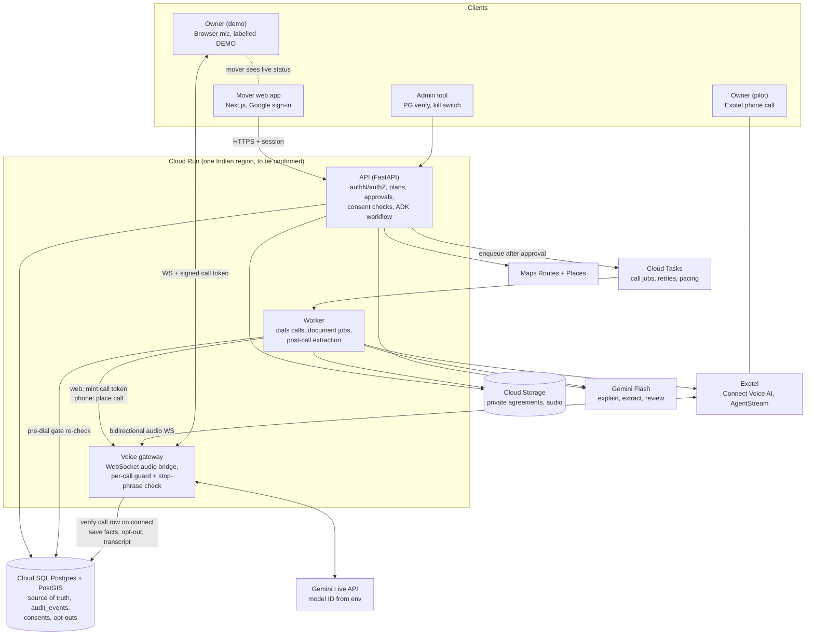
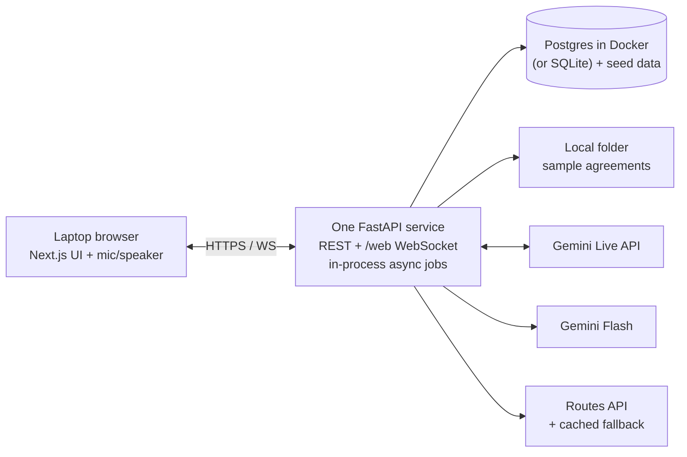

# Architecture Review: AI Relocation Agent

Reviewed: docs/PRD.md (last updated 8 Nov 2026), "Architecture", "AI agents", "Data model", "Phone calling" and "Build plan" sections.

Verification note: I had no network access to Google Cloud, Exotel or TRAI documentation in this review. Everything about external services below is either quoted from the PRD or marked **Unverified**. Nothing here confirms that a PRD claim is true.

---

## 1. Final architecture (production target, pilot and later)

Principle: the API owns every decision (who, what was approved, did the owner consent). The voice gateway and worker are executors that re-check state themselves and never trust a caller or the model.

Changes from the PRD diagram, and why:

- The PRD draws `API --> Gateway` and `Worker --> Data` only. Its text says the worker starts the call. The diagram should show `API -> Cloud Tasks -> Worker -> Gateway/Exotel`, with the DB check in the worker and again in the gateway.
- Cloud Tasks, Exotel, Maps and the DB connection from the gateway are added because the text depends on them but the diagram omits them. The gateway writes facts during the call (PRD Reliability), so it needs DB access.
- Gateway and worker both get independent gates (section 2, risk 1).

Component responsibilities (unchanged from PRD unless stated):

| Component | Owns | Must not do |
| --- | --- | --- |
| API | Auth, plan ownership, batch approval, consent lookups, ranking math, Maps calls | Place calls or hold audio |
| Worker | Dequeue, pre-dial gate, dial, post-call Extractor, doc analysis | Decide approval; it only verifies it |
| Gateway | Audio bridge, Live session lifecycle, resumption, tool execution (`record_fact`, `mark_opt_out`, `end_call`) | Start a call that has no valid approved call row |
| DB | Consents, opt-outs, approvals, audit trail | n/a |

Dependency direction: domain rules (consent, approval, opt-out, calling hours, call limits, scoring) live in one shared Python package (`packages/tools` or a new `policy` module) used by API, worker and gateway. Do not copy the checks into three services.

---

## 2. Top risks and gaps in the PRD design

Ordered by how badly each could hurt the demo or the pilot.

### Risk 1: Consent and approval are enforced at the API only (High)

PRD says the API checks identity, approval and consent, "and it can start a call only after those checks pass", but `WS /v1/calls/{id}/web` and the Exotel media WebSocket are separate entry points.

- Time-of-check/time-of-use gap: approval and consent are checked at approve time; the call may be dialed minutes later after an owner opt-out, a PG disable or a kill-switch flip. The PRD lists a worker check ("checks consent, approval, calling hours and `CALLING_ENABLED`") but not that the **gateway** re-verifies on connect.
- Gateway endpoints are reachable by anyone with the URL. Needs a signed, single-use, short-lived call token minted by the worker and bound to `call_id`, plus a DB read confirming status `approved/queued` before any audio is forwarded to Gemini.
- Opt-out is global across movers (PRD compliance gate) but the data model has no `opt_outs` table or unique constraint; it is implied by `consents.revoked_at`. Define one authoritative check and a uniqueness rule on phone hash.
- Idempotency: PRD mentions idempotency keys but the `calls` table has no key column or unique `(batch_id, pg_id)`. "Retry once after the mover approves" also conflicts with "one call per PG per mover" (default call limit). Decide which wins.

### Risk 2: Stop requests depend on the model calling a tool (High)

C-7 and the "rules code must enforce" list say a stop request must end the call "before any other step runs", but the only mechanism described is the model invoking `mark_opt_out`. That is a prompt-level control, which contradicts the PRD's own Prompt 0 rule. Telugu/Hindi stop phrases in noisy audio make this worse.

Fix: add a deterministic stop-phrase matcher on the input transcription stream in the gateway (multi-language list from the 30-case opt-out set) that writes the opt-out and tears down the session without waiting for the model. Keep the model tool as a second path.

### Risk 3: Live API session handling is under-specified (High for the demo)

- PRD states a connection lasts about 10 minutes, and uses `goAway` plus session resumption. **Unverified** against current docs: resumption token validity, whether a handle survives a gateway instance restart, and how transcription and audio buffers behave across reconnect.
- Cloud Run specifics not covered: WebSocket request timeout (configurable, with a platform maximum), instance concurrency for long-lived sockets, `--session-affinity`, minimum instances to avoid cold start on the first call, and graceful shutdown (SIGTERM) when a revision rolls out mid-call. **Unverified** for the exact current limits.
- Resumption handle and facts must live in the DB (or Redis), not gateway memory, or "save facts during the call" fails on instance loss.
- Tool-call durability: `record_fact` saves what the model says is confirmed. The model can mark `confirmed: true` wrongly. The post-call Extractor should reconcile against the transcript, and any disagreement should downgrade to "not confirmed". The PRD says the Extractor runs on "transcript and saved tool facts" but not who wins on conflict.
- Bidirectional echo: in the browser demo, the "owner" and the mover may be on one laptop. Echo and feedback will trigger false interruptions. Needs headset or two devices, and interruption (barge-in) handling tested.

### Risk 4: Model IDs are unverified (High)

- `gemini-3.8-live` is stated as "Generally available" in the PRD. **I could not verify that this ID exists or is GA in your project or region.** Same for the fallback `gemini-live-2.5-flash-native-audio`, and the Flash text model is explicitly "confirm in the console".
- The PRD already puts IDs in env vars (good). Missing: a startup check that calls each configured model once and fails fast, and a recorded smoke test in the 10 Nov Live API trial. The 10 Nov step in the build plan is the right place to settle this; treat it as a go/no-go gate for the voice architecture.
- Fallback model may differ in tool-call format, transcription fields, language support and voice names. A fallback that was never run is not a fallback.

### Risk 5: Region and latency (Medium to High)

- PRD wants the gateway in an India region near Exotel, and also asks to "confirm available Live API regions". If the Live API is not offered in an Indian region (**Unverified**), the audio loop becomes India -> another continent -> India. The 1.5 s P95 and 500 ms interruption targets may not hold, and Telugu quality is untested over that path.
- For the demo, the relevant path is browser (Hyderabad venue Wi-Fi) -> gateway -> Live endpoint. Venue Wi-Fi is a bigger risk than the architecture, and the PRD already says to use a hotspot.
- Data residency: audio and transcripts leaving India is a DPDP notice/consent question for the pilot (PRD says most duties apply from May 2027, from a vendor guide). Not a demo blocker.

### Risk 6: Agreement Checker "quote must be found in the document" (Medium)

For PDFs with a text layer this is a string search. For photos and scans (a stated input), there is no "document text" unless an OCR step produces one, and if Gemini produces that text, the verification is the model checking itself. Also non-English: PRD shows the original clause beside the translation, so the match must be against the original script. Pick an independent text source (PDF text layer, or a separate OCR) for verification, normalise whitespace and Unicode before matching, and decide the behaviour for fuzzy matches.

### Risk 7: Smaller gaps

- ADK scope: the PRD uses ADK for approval and human-in-the-loop. Approval is a safety control and should be a DB state transition checked in code; ADK tool-confirmation may be used for UX but must not be the enforcement point. ADK API stability and Python/TypeScript split (Next.js UI vs Python workflow) are **Unverified**.
- A-1 requires per-user isolation. The PRD says "row-level access" but does not say Postgres RLS vs application checks. Pick one; the cross-user test in Prompt 2 passes either way.
- Prompt injection from owner speech: the model has write tools (`record_fact`, `mark_opt_out`, `end_call`). Scope each tool to the current `call_id` server-side (never accept a `call_id` or `pg_id` argument from the model) and validate `field` against an enum.
- Logs mask phone numbers, but the calls table stores `phone_encrypted` and the Exotel path needs the plain number at dial time. Define who can decrypt (worker only) and which KMS key.
- Rent data (R-3) requires a source and date per rent range. The PRD gives no source for seed rent data; the demo needs one honest label ("sample data").
- Telecom claims (TRAI September 2026 amendment, number series, DLT) come from one vendor blog the PRD itself flags as not legal advice. **Unverified**; the architecture is correct to keep real calling behind `CALLING_ENABLED=false`.
- "Submit 13 Nov" while code written before 20 Nov may be disallowed: the PRD flags this. Architecture docs and a Live API test are safe regardless; app code is not until the owner confirms the rules.
- Timeline: the 10 Nov Live API test and 11 Nov application are tomorrow, so decisions in section 4 are time-sensitive.

---

## 3. Recommended minimal architecture for the Buildathon demo only

Goal: a reliable 3-minute demo of PRD P0 items (A-1, P-1, P-2, R-1 to R-3, L-1, C-1, C-2, C-3, C-4, C-5, C-7, T-1, D-1 to D-4), with the code-level safety gates kept real, since those are what the demo claims.

Keep:

- One backend process containing API, WebSocket voice bridge and background tasks (asyncio). Same code layout as the PRD packages so it splits into gateway/worker later.
- Google sign-in (A-1) and per-user plan ownership checks with a cross-user test.
- Real Routes API calls for commute (R-2 says "never from the model"), plus a cached last-good response per office/area pair as the offline fallback.
- Code-level gates (cheap, and they are the story): PG listed only if consent row valid (L-1), batch approval record before the WebSocket accepts (C-1), signed call token on the WebSocket, deterministic stop-phrase check plus `mark_opt_out` tool (C-7), `CALLING_ENABLED` and a kill switch flag, opening disclosure asserted in transcript (C-2).
- Seed data: 8 areas, 12 clearly fake PGs, labelled sample rent sources, fake agreements with seeded risks and one injected instruction (PRD Prompt 2 and 6).
- Pre-recorded full demo video (PRD backup plan).

Cut for the demo (with the cost of cutting):

| Cut | Cost | When it returns |
| --- | --- | --- |
| Cloud Tasks, separate worker, separate gateway service | No retry/pacing demo, one process to crash | Alpha |
| Cloud SQL, Terraform, canary, monitoring dashboards | None visible in 3 minutes | Pilot |
| Exotel and all phone code | None, PRD already says not to build it | Pilot |
| PostGIS spatial queries | Area lookup by id, not by geometry | Pilot |
| Retention jobs, DELETE /v1/me, audit dashboards | Privacy claims are stated, not shown; keep a basic audit_events insert | Pilot |
| ADK workflow engine (optional) | Simple explicit state machine in Python is easier to debug live; decision 4 below | Pilot |
| Fallback Live model and full session-resumption testing | A long call may drop | Keep calls under about 2 minutes in the demo, so resumption is not on the critical path, and still implement `goAway` handling if time permits |

Run location: laptop plus phone hotspot, not Cloud Run, unless deployment is already working by Day 1. A local run removes cold starts and deployment risk. The cost is no public URL for judges; a pre-built Cloud Run deploy can be kept as a secondary option.

Demo-specific safeguards: headset for the staged owner (echo), a demo-owner banner on the owner page (PRD Prompt 4), a scripted Telugu exchange rehearsed against the exact model ID that passed the 10 Nov test, and a "not confirmed" moment built into the script.

---

## 4. Decisions needing the owner's input

1. **Buildathon rules on pre-written code.** Blocks whether app code can be written before 20 Nov. PRD open check; unresolved. Affects whether 10 Nov testing is limited to a throwaway Live API probe.
2. **Voice model go/no-go on 10 Nov.** If `gemini-3.8-live` is not available or Telugu quality is poor, which fallback is acceptable (the 2.5 native-audio model, or a cascaded STT/LLM/TTS pipeline)? Please send me the exact IDs and regions your project shows in the console.
3. **Demo hosting.** Local laptop (lowest risk) vs Cloud Run (public link, more setup). Who needs to open it besides you?
4. **ADK in the demo or not.** Using it matches the PRD and possibly judging expectations (Google ecosystem); skipping it reduces risk. Is ADK use a Buildathon requirement or a preference?
5. **Cross-mover opt-out and call-limit policy.** One call per PG per mover vs "retry once after approval": which rule wins? And are opt-outs keyed by phone number hash or PG record?
6. **Isolation mechanism.** Postgres RLS (stronger, more setup) vs application-layer checks (faster).
7. **Where audio and transcripts may be processed.** Is processing outside India acceptable for the pilot, given DPDP and your legal review? Decides the region strategy.
8. **Rent data source for seed areas.** What real, citable source (listings sampled on a date, or your 20 collected PG details) goes into R-3, or is the demo explicitly labelled sample data?
9. **Staged owner.** Who plays the Telugu-speaking owner, on which device, and is a recorded fallback voice acceptable if the live call fails on stage?
10. **Employment/conflict check.** The PRD flags it as a risk; confirm before submitting on 13 Nov because it affects ownership statements in the application.

---

## Summary of what could not be verified

- That `gemini-3.8-live`, `gemini-live-2.5-flash-native-audio` or the Flash text model ID exist and are available to your project.
- Live API regions, quotas, session-resumption token lifetime, and current Cloud Run WebSocket timeout and concurrency limits.
- ADK Workflow/tool-confirmation behaviour in the current release.
- The TRAI September 2026 amendment, DLT requirements, number series, and Exotel AgentStream/Connect Voice AI approval status (all vendor-sourced in the PRD).
- Buildathon rules and FAQ.
